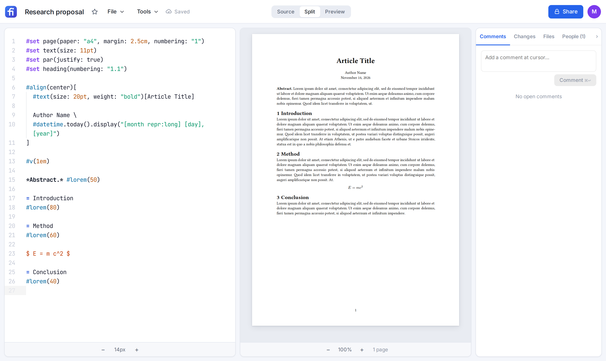
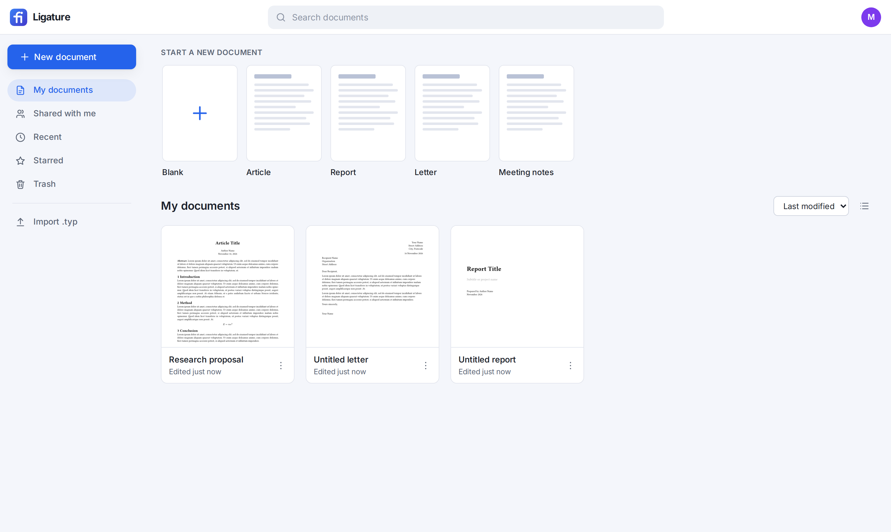

# Ligature

Google-Docs-style collaborative editing for [Typst](https://typst.app). Sign in, create documents, share them with people or by link, and write together with a live PDF preview — all in the browser, on your own server.

*(Formerly Glyph Quorum. The repository, package and container image names are unchanged.)*





## Features

**Documents**
- **File manager** — My documents, Shared with me, Recent, Starred and Trash, with first-page previews, search, sorting, and grid or list layouts
- **Templates** — start from Blank, Article, Report, Letter or Meeting notes, or import existing `.typ` files (drag and drop works)
- **Rename, star, copy, trash and restore** — from the file manager or inside the editor
- **Version history** — automatic snapshots roughly every ten minutes of editing; preview and restore any of them

**Collaboration**
- **Accounts** — email and password sign-in; your name and cursor colour follow you everywhere
- **Admin centre** — manage users (roles, disable, reset password, sign out, delete with document transfer), create invite links, choose who can sign up, and review an activity log
- **Sharing** — add people by email as *Editor* or *Viewer*, or turn on link sharing (view or edit) for anyone signed in. Changes to access apply immediately, even to people who have the document open
- **Live editing** — shared editing powered by Y.js and Hocuspocus; see every collaborator's cursor in real time
- **Comments and Track Changes** — inline comments, and suggested edits that can be accepted or rejected
- **Spell check** — with a per-document shared dictionary

**Writing**
- **Live preview** — compiles on the server as you type; only the pages on screen are re-rendered, with no flicker
- **Files** — upload images and `.bib` files per document, with thumbnails; click an image to insert it
- **Reference library** — a personal, document-independent library. Add references by hand, from a DOI, or by importing a `.bib` file, then cite them from any document with `@key` or `[@key]`; the bibliography is generated automatically with nothing to upload. Optional per document
- **Citations** — author–date or numbered styles; a document's own `.bib` files still work and take priority
- **Dark mode** — light, dark, or follow the system setting
- **Slash commands** — type `/` for headings, lists, tables, images, math, code blocks and more
- **Export** — download the `.typ` source or the PDF

## First-run setup

A new server shows a setup wizard instead of the sign-in page:

1. **Setup code** — printed in the server log when it starts (`docker compose logs`), so only someone who controls the server can claim it. Set `SETUP_TOKEN` to choose the code yourself.
2. **Administrator** — the first account, with full access to the admin centre.
3. **Server settings** — a name for the server and who can sign up: *invite only* (recommended), *anyone*, or *closed*.

Everything can be changed afterwards under **Admin centre** in the account menu.

**Locked out?** Promote an account from the command line (safe while the server is running):

```bash
npm -w server run make-admin -- someone@example.com
# with Docker:
docker compose exec -u node glyph-quorum node dist/cli.js someone@example.com
```

**Upgrading from Glyph Quorum:** the old anonymous "rooms" are migrated automatically. The administrator created during setup becomes the owner of every existing room (with its files), and can then share them. Old room passwords are discarded — access is controlled by sharing instead.

## Reference library

Each user has a private library under **Reference library** in the account menu. In any document, `@Smith2020` renders as "Smith (2020)" and `[@Smith2020]` as "(Smith, 2020)", and a bibliography is appended automatically.

- Citations are looked up in the libraries of the document's **owner and the editors it is shared with**, owner first, so every collaborator sees the same result.
- Only the entries a document actually cites are used; the rest of a library is never exposed to collaborators.
- A `.bib` file uploaded to a document takes priority over library entries with the same key.
- Each document can switch the library off in its **Files** tab.
- DOI lookup contacts Crossref and DataCite from the server. If the server has no internet access, add references by hand or by import instead.

## Security

- Passwords are hashed with scrypt and a per-password salt. Sessions are random tokens held in `HttpOnly`, `SameSite=Lax` cookies (also `Secure` over HTTPS); only a hash of the token is stored.
- Every API call and every live connection is authorised per document on the server. Viewers are read-only at the protocol level, not just in the interface.
- Cross-site requests and cross-site WebSocket connections are rejected; sign-in, sign-up, setup, compiling and uploads are rate limited.
- Admin routes are checked on the server for every request. Disabling an account, or resetting its password, signs it out everywhere and closes its live editing connections. The last administrator cannot be removed, and invite links and temporary passwords are shown once and stored only as hashes.
- A strict Content-Security-Policy is sent with every response; uploaded files are served sandboxed, so an uploaded SVG cannot run script.
- Typst runs with its file access confined to the document's own folder, with a time limit and bounded concurrency.
- The Docker image runs as an unprivileged user.

Run it behind HTTPS (a reverse proxy or tunnel) for anything beyond local use. Link sharing still requires the visitor to sign in.

## Configuration

| Variable | Default | Purpose |
|---|---|---|
| `PORT` | `3000` | Port the server listens on |
| `SETUP_TOKEN` | *(random, printed to the log)* | Setup code required by the first-run wizard |
| `ALLOW_REGISTRATION` | `true` | Only sets the wizard-less default (`false` = invite only). Use **Admin centre → Settings** instead |
| `DATA_DIR` | `./data` (in `server/`) | Where the database and uploaded files are stored — back this up |
| `TRUST_PROXY` | `loopback, linklocal, uniquelocal` | Which proxies may set `X-Forwarded-*` ([Express syntax](https://expressjs.com/en/guide/behind-proxies.html)) |
| `ALLOWED_ORIGINS` | *(none)* | Extra comma-separated origins allowed to call the API, if your proxy rewrites the host |

## Port

The server listens on **port 3000** by default. Override with the `PORT` environment variable:

```
PORT=8080 node dist/index.js
```

## Install

### One-line (Linux / macOS)

```bash
curl -fsSL https://raw.githubusercontent.com/XWBarton/glyph-quorum/main/install.sh | bash
```

This will:
1. Install Node.js 20 if not present (via `apt-get` on Linux or `brew` on macOS)
2. Install Typst if not present
3. Clone the repository into `./glyph-quorum`
4. Install dependencies and build
5. Start the server on port 3000

Open `http://localhost:3000` when it's running.

### Manual

Requirements: **Node.js 20+** and **Typst** on your PATH. (One dependency, `better-sqlite3`, downloads a prebuilt binary during `npm install`; on unusual platforms it needs a C++ toolchain.)

```bash
git clone https://github.com/XWBarton/glyph-quorum.git
cd glyph-quorum
npm install
npm run build
cd server
node dist/index.js
```

### Custom port

```bash
PORT=8080 node dist/index.js
```

## Docker

Build the container locally:

```bash
docker build -t glyph-quorum .
```

Run it:

```bash
docker run --rm -p 3000:3000 -v glyph-quorum-data:/app/server/data glyph-quorum
```

Or run with Docker Compose:

```bash
docker compose up -d --build
```

### Behind a reverse proxy or Cloudflare Tunnel

No extra configuration needed. Point your tunnel or proxy at `localhost:3000` (or your custom port) and the client will automatically connect over `wss://` when served over HTTPS.

## Keep running (PM2)

To run the server persistently in the background and have it restart on reboot:

```bash
npm install -g pm2
cd glyph-quorum/server
PORT=3000 pm2 start dist/index.js --name glyph-quorum
pm2 save
pm2 startup
```

`pm2 startup` prints a `sudo env ...` command — copy and run it to register with systemd.

Useful commands:

```bash
pm2 logs glyph-quorum      # tail logs
pm2 restart glyph-quorum   # restart
pm2 stop glyph-quorum      # stop
```

## Update

```bash
cd glyph-quorum
git pull --ff-only
npm install
npm run build
```

Then restart the server.

Or re-run the one-line installer — it detects the existing directory and updates it in place.

## Related

| | |
|---|---|
| **[Glyph](https://github.com/XWBarton/glyph)** | Local desktop editor for macOS — offline, single-user, no server needed |

---

## Development

With Docker (nothing else to install):

```bash
docker compose -f docker-compose.dev.yml up -d --build
```

Or directly, with Node.js 20+ and Typst installed:

```bash
npm install
npm run dev
```

Either way, open `http://localhost:5173`. The Vite dev server (hot reload) proxies the API and the collaboration WebSocket to the server on port 3000, so the browser only talks to one origin, exactly as in production.

The product name and logo live in `client/src/lib/brand.ts` and `client/public/logo.svg`.

---

Found this useful and want to help support maintenance?

<a href='https://ko-fi.com/X8X21WPZ2R' target='_blank'></a>
